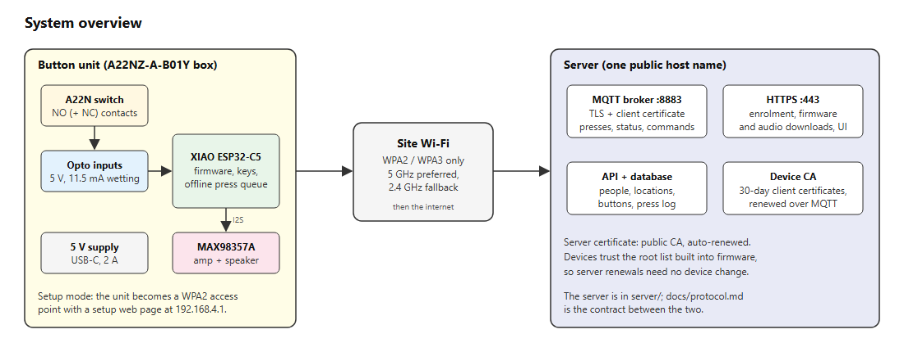
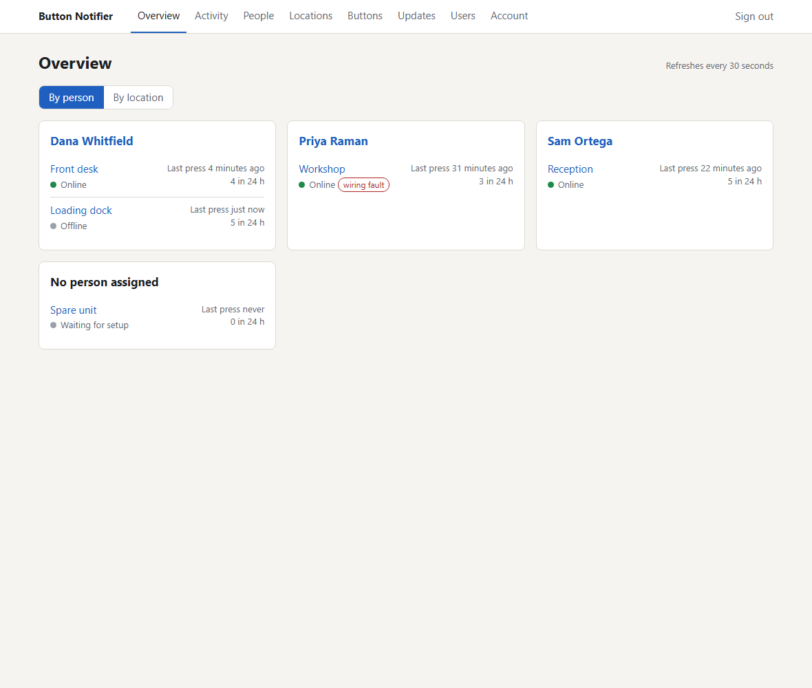
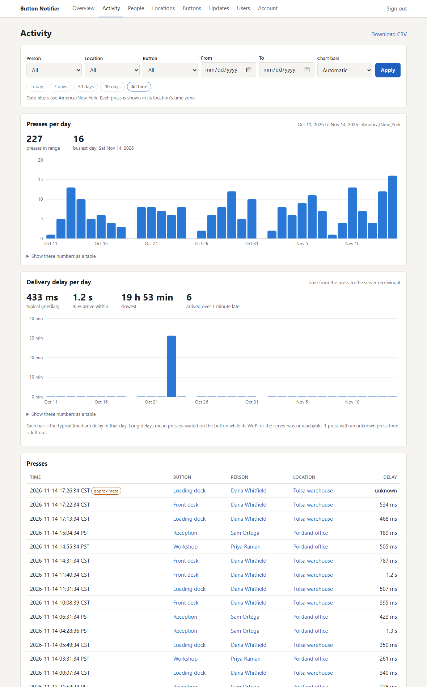
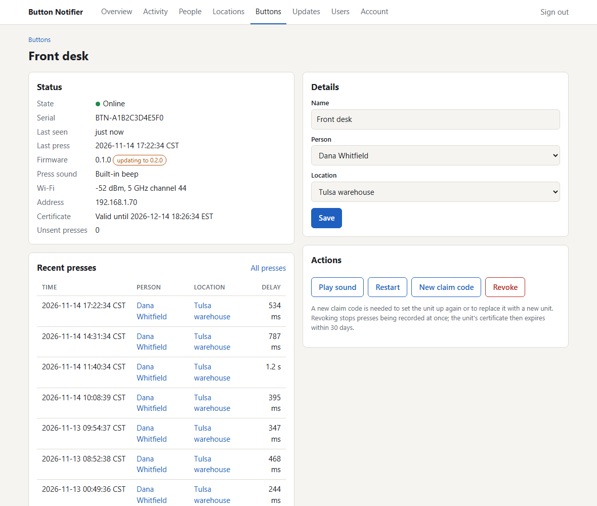
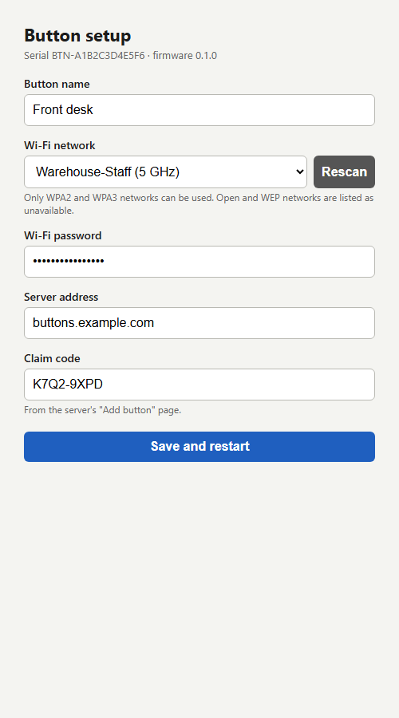
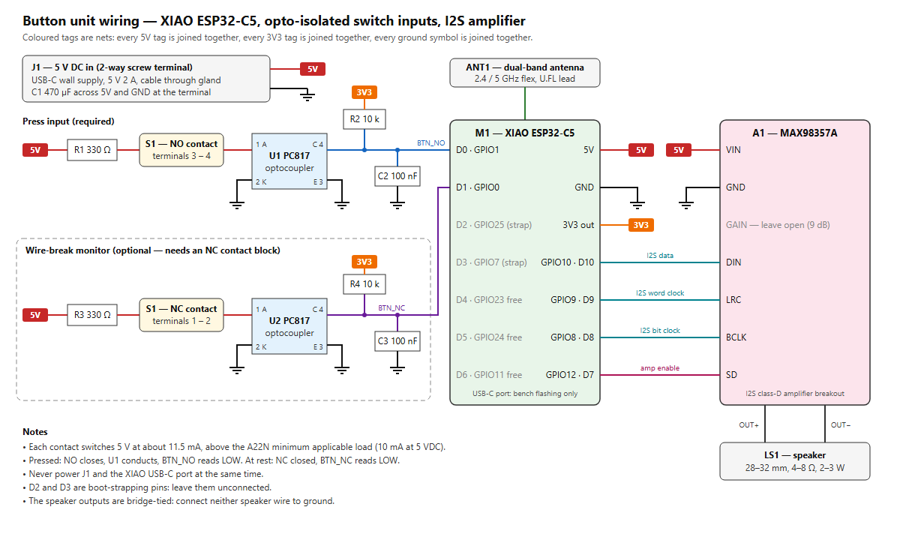

# Canary

A Wi-Fi push button that logs every press, with its date and time, to a server you run.

The button is an Omron industrial pushbutton in a yellow control box. Inside is a small ESP32-C5 board that joins the local Wi-Fi, keeps a secure connection to the server and plays a sound when pressed. The server has a web interface that shows presses by person and by location, and manages buttons spread across many sites.



## Status

This is a design and software project. No hardware has been built yet.

| Part | Where | State |
|---|---|---|
| Hardware design, wiring, assembly steps | [docs/hardware.md](docs/hardware.md) | Designed, not yet built |
| Button firmware (ESP-IDF, ESP32-C5) | [firmware/](firmware/) | Written, not yet compiled or run |
| Server and web interface | [server/](server/) | Tests pass and it runs locally; the Docker deployment has not been run |
| Button emulator and local test rig | [emulator/](emulator/) | End-to-end test passes against the real server |
| Device–server protocol | [docs/protocol.md](docs/protocol.md) | Defined; implemented by the server and the emulator |
| Screen mocks | [docs/mocks/](docs/mocks/) | Generated from the real pages with sample data |

## What it does

**The button**

- Logs each press with the button's own clock time, to the millisecond.
- Stores presses in flash until the server confirms them, so nothing is lost during a Wi-Fi outage, a server outage or a power cut.
- Plays a sound on each press; the sound can be replaced from the server.
- Is set up from a phone or laptop: the button opens its own protected Wi-Fi network and a setup page for the name, Wi-Fi details and a claim code.
- Joins WPA2 and WPA3 networks only, and prefers 5 GHz over 2.4 GHz.
- Receives firmware updates from the server, and rolls back by itself if a new version cannot reach the server.

**The server**

- Shows buttons grouped by person or by location; a person or location can have several buttons.
- Charts presses per hour, day, week or month, and the delay between a press and its arrival, with filters for person, location, button and date.
- Lists every press and exports to CSV.
- Adds, assigns, renames, restarts and revokes buttons, and sends them firmware and sound updates.
- Has viewer, manager and administrator accounts, with optional two-step sign-in and a change log.

**Security**

- The button talks to the server over TLS only. Each button makes its own key and holds a 30-day client certificate that renews automatically.
- The server's own certificate renews automatically; buttons trust public root certificates, so renewals need no change on the button.
- The firmware supports secure boot and flash encryption for production units.
- Web sign-in uses Argon2 password hashing, lockout after repeated failures, and CSRF protection on every form.

## Screens

| Overview by person | Activity charts and log |
|---|---|
|  |  |

| One button | Button setup page (served by the button) |
|---|---|
|  |  |

All 29 screens are in [docs/mocks/](docs/mocks/). To browse them as click-through pages, clone the repository and open `docs/mocks/index.html`.

## Try it without hardware

The emulator behaves like a button, so the whole system can be run on one computer. You need Python 3.11 or later. These commands are for Windows; on macOS or Linux use `.venv/bin/` in place of `.venv\Scripts\`.

```
cd server
python -m venv .venv
.venv\Scripts\pip install -r requirements-dev.txt
cd ..\emulator
..\server\.venv\Scripts\python run_rig.py
```

1. Open http://localhost:8000 and sign in with the address and password the rig prints.
2. On the Buttons page, add a button and note its claim code.
3. Open the emulated button at http://localhost:8090 and follow its link to the setup page.
4. Choose the network `Warehouse-Staff`, password `blue-forklift-42`, server address `localhost`, and enter the claim code.
5. Click the red button. The press appears on the server.

From the emulator's panel you can also switch the Wi-Fi off, cut the power, or break a wire, and watch how the server sees it. More in [emulator/README.md](emulator/README.md).

## Hardware

| Part | Role |
|---|---|
| Omron A22NZ-A-B01Y control box | Enclosure, 80 × 80 × 60 mm, IP65 |
| Omron A22N pushbutton with NO contact | The button; an optional NC contact adds wire-break detection |
| Seeed XIAO ESP32-C5 | Microcontroller with 2.4 and 5 GHz Wi-Fi |
| PC817 optocouplers | Switch inputs at 5 V and 11.5 mA, above the contacts' minimum load |
| MAX98357A amplifier and a small speaker | Press sound |
| 5 V USB-C supply | Power |



Parts cost roughly $60–75 per unit in single quantities. The full parts list, pin map, calculations and assembly steps are in [docs/hardware.md](docs/hardware.md).

## Repository layout

| Folder | Contents |
|---|---|
| [docs/](docs/) | Hardware design, wiring diagrams, protocol, datasheets, screen mocks |
| [firmware/](firmware/) | ESP-IDF project for the button |
| [server/](server/) | FastAPI web application, device certificate authority, MQTT handling, Docker deployment files |
| [emulator/](emulator/) | Software button, local test broker, one-command test rig, end-to-end test |

Each folder has its own README with build, run and test instructions.

## Running a real server

The server needs one small Linux machine with Docker (1 CPU and 1 GB of memory is enough), a DNS name, and ports 80, 443 and 8883 open. Steps are in [server/README.md](server/README.md). The deployment files are written but have not been run yet.

## Known gaps

- The firmware has not been compiled; expect build errors on the first attempt.
- The emulator re-implements the firmware's behaviour in Python. It tests the server and the protocol, not the C code.
- Revoking a button stops its presses being recorded at once, but the broker accepts its connection until its certificate expires (30 days at most).
- The database is not encrypted by the application; put it on an encrypted disk.

## Datasheets

The files in [docs/datasheets/](docs/datasheets/) are the property of the companies that make those products (Omron, Espressif, Seeed Studio, Analog Devices and Sharp). They are included unmodified, for reference only, and are not covered by the MIT licence that applies to the rest of this repository. See [docs/datasheets/README.md](docs/datasheets/README.md) for each file's owner and source.

## Licence

The code, documentation and diagrams in this repository are released under the [MIT licence](LICENSE). The datasheets in `docs/datasheets/` are excluded; they remain the property of their manufacturers.
