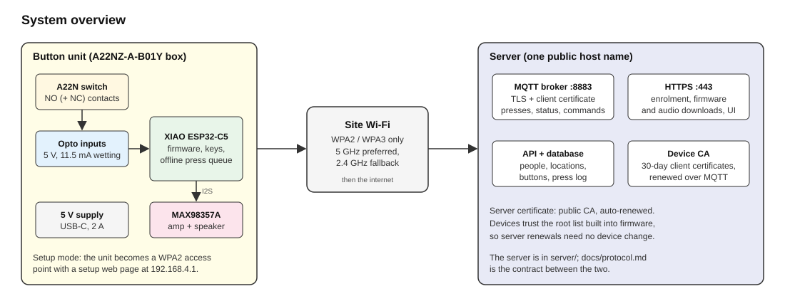
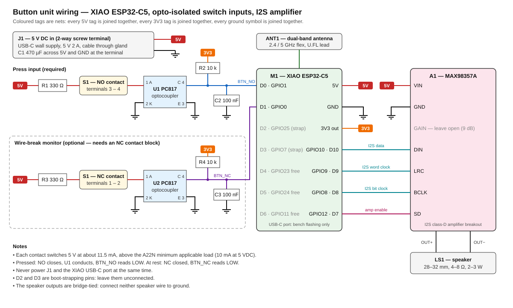

# Button unit hardware

One unit is an Omron A22N switch in an A22NZ-A-B01Y control box, with a small carrier board that holds the microcontroller, two opto-isolated inputs and an audio amplifier.

## Datasheets

The files go in [datasheets/](datasheets/). They are not stored in the repository; [datasheets/README.md](datasheets/README.md) lists where to download each one.

| File | Covers | Used for |
|---|---|---|
| `Omron_A22N_series_datasheet.pdf` | A22N switches, contact blocks, A22NZ control boxes | Contact ratings, minimum load, box dimensions |
| `Omron_A22NN_example_datasheet.pdf` | One A22NN pushbutton (A22NN-RNM-NGA-G100-NN) | Example of a single NO model |
| `esp32-c5_datasheet_en.pdf` | ESP32-C5 chip | Strapping pins, electrical limits |
| `Seeed_XIAO_ESP32C5_schematic.pdf` | XIAO ESP32-C5 module | Power path, LED, antenna |
| `XIAO_ESP32C5_Pinout.xlsx` | XIAO ESP32-C5 module | Pad-to-GPIO map |
| `MAX98357A-MAX98357B.pdf` | I2S amplifier | SD_MODE thresholds, gain, supply |
| `PC817_optocoupler.pdf` | Optocoupler | Forward voltage, transfer ratio |

Not retrieved: the Omron page for item 59712 (the site blocks automated downloads). The design assumes an A22N-series operator with one NO contact block; confirm the exact model against the series datasheet.

## Facts taken from the datasheets

| Fact | Value | Consequence |
|---|---|---|
| A22N minimum applicable load | 10 mA at 5 VDC (series datasheet); 6 mA at 5 VDC on one newer model page | A plain 3.3 V pull-up is too weak. Each contact switches 5 V at 11.5 mA through an optocoupler. |
| A22NZ-A-B01Y outside size | 80 × 80 × 59.9 mm, one 22.3 mm hole | Carrier board must be small; measure the free space before cutting it. |
| A22NZ-A-B01Y cable entries | Two 21.4 mm side lead holes, two 14 mm bottom lead holes | One side hole takes an M20 gland for power; the other can be the speaker port. |
| A22NZ-A-B01Y mounting | Two 4.4 mm oval holes; four M4 rear tapping holes (11 mm deep) | Wall mounting without drilling the box. |
| A22NZ-A-B01Y contact limit | Linked (stacked) screw-terminal units and the double-contact Push-In Plus unit do not fit | Use a single layer of contact blocks: one NO, optionally one NC beside it. |
| ESP32-C5 strapping pins | GPIO2, 3, 7, 25, 26, 27, 28 | XIAO pads D2 (GPIO25) and D3 (GPIO7) stay unconnected. |
| PC817 transfer ratio | 50 % minimum at 5 mA | 11.5 mA in gives at least 5 mA out; the 10 kΩ pull-up needs 0.33 mA. |
| MAX98357A supply | 2.5 to 5.5 V | Runs from the 5 V rail. |
| MAX98357A SD_MODE | Below 0.16 V is shutdown; above 1.4 V selects the left channel | A 3.3 V GPIO switches the amplifier on and off. |

## Bill of materials (per unit)

| Ref | Part | Qty | Notes |
|---|---|---|---|
| — | Omron A22NZ-A-B01Y control box | 1 | Supplied |
| S1 | Omron A22N operator with NO contact block | 1 | Supplied (item 59712) |
| S1b | Omron A22N NC contact block | 0–1 | Optional, for the wire-break monitor |
| M1 | Seeed XIAO ESP32-C5 | 1 | 8 MB flash, dual-band Wi-Fi 6 |
| ANT1 | 2.4/5 GHz flex antenna with U.FL lead | 1 | One ships with the XIAO |
| U1, U2 | PC817 optocoupler, DIP-4 | 1–2 | U2 only with the NC contact |
| R1, R3 | 330 Ω, 0.25 W | 1–2 | Contact wetting current |
| R2, R4 | 10 kΩ | 1–2 | Pull-ups to 3V3 |
| C2, C3 | 100 nF ceramic | 1–2 | Input filter |
| C1 | 470 µF, 10 V electrolytic | 1 | 5 V bulk capacitor |
| A1 | MAX98357A I2S amplifier breakout | 1 | Adafruit 3006 or equivalent |
| LS1 | Speaker, 28–32 mm, 4–8 Ω, 2–3 W | 1 | |
| J1 | 2-way screw terminal, 3.5 or 5 mm pitch | 1 | 5 V input |
| J2 | 3- or 4-way screw terminal | 1 | Switch wires |
| — | 5 V 2 A USB-C wall supply and cable | 1 | Cable end cut and landed on J1 |
| — | M20 cable gland, IP68 | 1 | For the 21.4 mm side lead hole |
| — | Adhesive acoustic vent membrane, IP67 | 1 | Covers the speaker port |
| — | Perfboard about 50 × 30 mm, 22 AWG wire, ferrules, adhesive standoffs | — | |
| — | Label with serial number and setup password | 1 | Printed after first boot |

## Wiring

A PNG copy is at [diagrams/wiring.png](diagrams/wiring.png).

### Pin map

| Signal | XIAO pad | GPIO | Connects to | Level |
|---|---|---|---|---|
| BTN_NO | D0 | GPIO1 | U1 pin 4, R2, C2 | LOW while pressed |
| BTN_NC | D1 | GPIO0 | U2 pin 4, R4, C3 | LOW while released |
| I2S_DOUT | D10 | GPIO10 | A1 DIN | |
| I2S_LRCLK | D9 | GPIO9 | A1 LRC | |
| I2S_BCLK | D8 | GPIO8 | A1 BCLK | |
| AMP_SD | D7 | GPIO12 | A1 SD | HIGH while playing |
| Status LED | on board | GPIO27 | — | Inside the box; bench use only |
| Power in | 5V | — | J1 +, C1 +, A1 VIN, R1, R3 | |
| 3V3 out | 3V3 | — | R2, R4 | |
| Ground | GND | — | J1 −, C1 −, A1 GND, U1/U2 pins 2 and 3, C2, C3 | |

Unused: D2 and D3 (strapping pins, leave open), D4, D5, D6.

### Net list

| Net | Nodes |
|---|---|
| 5V | J1-1, C1+, M1-5V, A1-VIN, R1-a, R3-a |
| GND | J1-2, C1−, M1-GND, A1-GND, U1-2, U1-3, U2-2, U2-3, C2-b, C3-b |
| 3V3 | M1-3V3, R2-a, R4-a |
| NO_A | R1-b, J2-1 (to S1 terminal 3) |
| NO_B | J2-2 (from S1 terminal 4), U1-1 |
| NC_A | R3-b, J2-3 (to S1 terminal 1) |
| NC_B | J2-4 (from S1 terminal 2), U2-1 |
| BTN_NO | U1-4, R2-b, C2-a, M1-D0 |
| BTN_NC | U2-4, R4-b, C3-a, M1-D1 |
| I2S_DOUT | M1-D10, A1-DIN |
| I2S_LRCLK | M1-D9, A1-LRC |
| I2S_BCLK | M1-D8, A1-BCLK |
| AMP_SD | M1-D7, A1-SD |
| SPK+ / SPK− | A1 output terminals, LS1 |

Check the contact block's terminal numbers against its own marking; Omron marks NO as 3–4 and NC as 1–2 on most blocks.

### Design calculations

- **Contact current:** (5.0 V − 1.2 V) ÷ 330 Ω = 11.5 mA. At a low supply of 4.75 V it is 10.8 mA. Both exceed the 10 mA minimum.
- **R1 dissipation:** 11.5 mA² × 330 Ω = 44 mW.
- **NC monitor draw:** the NC contact is closed at rest, so it draws 11.5 mA continuously.
- **Input filter:** 10 kΩ × 100 nF = 1 ms; the firmware adds a 30 ms debounce.
- **Supply budget:** Wi-Fi transmit peaks near 0.4 A at 5 V, the amplifier peaks near 0.8 A into 4 Ω, the inputs take 23 mA. A 2 A supply covers it; C1 absorbs the peaks.

## Assembly

1. **Bench-flash the XIAO.** Connect it by USB-C with nothing else attached and flash the firmware (see [../firmware/README.md](../firmware/README.md)). Note the serial number and setup password it prints, and make the label.
2. **Fit the antenna.** Press the U.FL lead onto the XIAO connector until it clicks.
3. **Build the carrier board.**
   1. Solder the XIAO (on headers or directly), U1, R1, R2, C2, J1, J2 and C1. Watch C1 polarity.
   2. Add U2, R3, R4 and C3 if you use the NC contact.
   3. Wire the amplifier: VIN, GND, DIN, LRC, BCLK, SD. Leave GAIN open.
4. **Test the board before boxing it.**
   1. Power J1 from the 5 V supply with the USB-C port unplugged. Never power both.
   2. Check 5 V on the amplifier VIN and 3.3 V on the XIAO 3V3 pad.
   3. Short J2-1 to J2-2 with a wire: the unit must beep.
5. **Prepare the box.**
   1. Open one 21.4 mm side lead hole and fit the M20 gland.
   2. Open the opposite side lead hole as the speaker port and cover it from inside with the vent membrane.
   3. Fix the speaker over the port with adhesive or a printed ring.
6. **Mount the switch.** Fit the operator in the 22.3 mm cover hole, tighten its ring and snap on the contact block or blocks in a single layer.
7. **Wire the switch.** Run two wires from the NO block (terminals 3 and 4) to J2-1 and J2-2, and two from the NC block (1 and 2) to J2-3 and J2-4. Use ferrules. Leave enough slack to open the cover.
8. **Fit the board.** Stick it on standoffs on the case floor, clear of the contact block when the cover closes. Stick the antenna flat on a side wall, away from the speaker and power wires.
9. **Connect power.** Pass the supply cable through the gland, land red on J1-1 (5 V) and black on J1-2 (GND), and tighten the gland as strain relief.
10. **Close and label.** Screw the cover on with its four M4 screws and apply the label.
11. **Commission.** Follow "First setup" in the firmware README, press the button, and confirm the beep and the logged press on the server.

## Safety notes

- The yellow box is Omron's emergency-stop version. If the operator is a red mushroom head, that red-on-yellow combination is reserved for real emergency stops (ISO 13850). Label the unit clearly as a notification button, or use another operator colour.
- Everything inside the box is 5 V. Do not route mains into it.
